# FinCore — Database ERD

Entity-Relationship Diagram for all PostgreSQL tables defined in `migrations/000001` through `migrations/000006`.

## Entity-Relationship Diagram

```mermaid
erDiagram
    users {
        uuid id PK
        text email UK "NOT NULL"
        text password_hash "NOT NULL"
        text status "NOT NULL DEFAULT active"
        timestamptz created_at "NOT NULL"
    }

    accounts {
        uuid id PK
        uuid user_id FK "NOT NULL -> users.id"
        text account_number UK "NOT NULL"
        char_3 currency "CHAR(3) VND | USD"
        text account_type "customer | settlement"
        text status "active | frozen | closed"
        bigint balance_amount "minor units; >= 0 for customer"
        timestamptz created_at "NOT NULL"
        timestamptz updated_at "NOT NULL"
    }

    ledger_transactions {
        uuid id PK
        text reference UK "NOT NULL"
        text transaction_type "deposit | withdrawal | transfer | reversal | adjustment"
        text status "posted | reversed"
        uuid reversal_of_id FK,UK "NULLABLE -> ledger_transactions.id"
        timestamptz created_at "NOT NULL"
    }

    ledger_entries {
        uuid id PK
        uuid transaction_id FK "NOT NULL -> ledger_transactions.id"
        uuid account_id FK "NOT NULL -> accounts.id"
        text entry_type "debit | credit"
        bigint amount "minor units; > 0"
        char_3 currency "CHAR(3) VND | USD"
        timestamptz created_at "NOT NULL (append-only)"
    }

    transfers {
        uuid id PK
        uuid user_id FK "NOT NULL -> users.id"
        text idempotency_key "UK(user_id, idempotency_key)"
        text request_hash "NOT NULL"
        uuid source_account_id FK "NOT NULL -> accounts.id"
        uuid destination_account_id FK "NOT NULL -> accounts.id"
        bigint amount "minor units; > 0"
        char_3 currency "CHAR(3) VND | USD"
        text status "completed | failed"
        uuid ledger_transaction_id FK,UK "NOT NULL -> ledger_transactions.id"
        timestamptz created_at "NOT NULL"
    }

    payments {
        uuid id PK
        uuid user_id FK "NOT NULL -> users.id"
        uuid account_id FK "NOT NULL -> accounts.id"
        text idempotency_key "UK(user_id, idempotency_key)"
        text request_hash "NOT NULL"
        text direction "deposit | withdrawal"
        bigint amount "minor units; > 0"
        char_3 currency "CHAR(3) VND | USD"
        text bank_code "NOT NULL"
        text bank_account_number "NOT NULL"
        text external_ref UK "NULLABLE"
        text status "pending | completed | failed"
        text failure_reason "NOT NULL DEFAULT ''"
        uuid ledger_transaction_id FK,UK "NULLABLE -> ledger_transactions.id"
        timestamptz created_at "NOT NULL"
        timestamptz updated_at "NOT NULL"
    }

    webhook_endpoints {
        uuid id PK
        uuid user_id FK "NOT NULL -> users.id ON DELETE CASCADE"
        text url "NOT NULL"
        text secret "NOT NULL"
        text_array events "TEXT[] DEFAULT {}"
        boolean is_active "NOT NULL DEFAULT true"
        timestamptz created_at "NOT NULL"
        timestamptz updated_at "NOT NULL"
    }

    outbox_events {
        uuid id PK
        uuid user_id FK "NOT NULL -> users.id"
        text aggregate_type "NOT NULL"
        uuid aggregate_id "NOT NULL"
        text event_type "NOT NULL"
        jsonb payload "NOT NULL"
        text status "pending | completed | failed"
        int attempts "NOT NULL DEFAULT 0"
        int max_attempts "NOT NULL DEFAULT 5"
        timestamptz next_retry_at "NOT NULL"
        text last_error "NOT NULL DEFAULT ''"
        timestamptz created_at "NOT NULL"
        timestamptz processed_at "NULLABLE"
    }

    reconciliation_runs {
        uuid id PK
        uuid user_id FK "NOT NULL -> users.id"
        text bank_code "NOT NULL"
        char_3 currency "CHAR(3) VND | USD"
        timestamptz period_start "NOT NULL"
        timestamptz period_end "NOT NULL (>= period_start)"
        text status "completed | has_discrepancies"
        int total_bank_records "NOT NULL DEFAULT 0"
        int total_internal_records "NOT NULL DEFAULT 0"
        int matched_count "NOT NULL DEFAULT 0"
        int discrepancy_count "NOT NULL DEFAULT 0"
        timestamptz created_at "NOT NULL"
    }

    reconciliation_items {
        uuid id PK
        uuid run_id FK "NOT NULL -> reconciliation_runs.id ON DELETE CASCADE"
        text external_ref "NOT NULL DEFAULT ''"
        uuid payment_id FK "NULLABLE -> payments.id"
        text match_status "matched | amount_mismatch | direction_mismatch | status_mismatch | missing_in_fincore | missing_in_bank"
        bigint bank_amount "NULLABLE minor units"
        bigint internal_amount "NULLABLE minor units"
        text bank_direction "NOT NULL DEFAULT ''"
        text internal_direction "NOT NULL DEFAULT ''"
        text bank_status "NOT NULL DEFAULT ''"
        text internal_status "NOT NULL DEFAULT ''"
        char_3 currency "CHAR(3) VND | USD"
        text resolution_status "not_applicable | open | resolved | ignored"
        text resolution_note "NOT NULL DEFAULT ''"
        uuid resolved_by FK "NULLABLE -> users.id"
        timestamptz resolved_at "NULLABLE"
        timestamptz created_at "NOT NULL"
    }

    ledger_audit_runs {
        uuid id PK
        uuid user_id FK "NOT NULL -> users.id"
        text status "healthy | anomalies_found"
        int checked_transactions "NOT NULL DEFAULT 0"
        int unbalanced_transactions "NOT NULL DEFAULT 0"
        int checked_accounts "NOT NULL DEFAULT 0"
        int drifted_accounts "NOT NULL DEFAULT 0"
        jsonb anomalies "NOT NULL DEFAULT []"
        timestamptz created_at "NOT NULL"
    }

    users ||--o{ accounts : "owns"
    users ||--o{ transfers : "initiates"
    users ||--o{ payments : "initiates"
    users ||--o{ webhook_endpoints : "configures"
    users ||--o{ outbox_events : "owns events"
    users ||--o{ reconciliation_runs : "runs"
    users ||--o{ ledger_audit_runs : "audits"

    reconciliation_runs ||--|{ reconciliation_items : "contains"
    payments ||--o{ reconciliation_items : "reconciled in"

    ledger_transactions ||--o| ledger_transactions : "reversed by"
    ledger_transactions ||--|{ ledger_entries : "contains (>= 2)"
    accounts ||--o{ ledger_entries : "booked in"

    accounts ||--o{ transfers : "source_account"
    accounts ||--o{ transfers : "destination_account"
    ledger_transactions ||--o| transfers : "recorded by"

    accounts ||--o{ payments : "target account"
    ledger_transactions ||--o| payments : "settled by"
```

## Module Ownership

Each domain module in `internal/modules/` owns writes to its respective tables:

| Module | Tables Owned | Migration(s) | Purpose |
| --- | --- | --- | --- |
| `auth` | `users` | `000001`, `000004` (system seed) | User identity, credentials, account status |
| `account` | `accounts` | `000002`, `000004` | Customer & settlement accounts and cached balances |
| `ledger` | `ledger_transactions`, `ledger_entries` | `000002` | Append-only double-entry accounting journal |
| `transfer` | `transfers` | `000003` | Idempotent internal account-to-account transfers |
| `payment` | `payments` | `000004` | External bank deposits & withdrawals |
| `webhook` | `webhook_endpoints`, `outbox_events` | `000005` | Transactional outbox & outbound webhook subscriptions |
| `reconciliation` | `reconciliation_runs`, `reconciliation_items`, `ledger_audit_runs` | `000006` | Bank statement reconciliation & internal ledger integrity audits |

## Key Invariants, Constraints & Triggers

- **Money Representation:** All monetary amounts (`balance_amount`, `amount`) use `BIGINT` in minor units (`VND` in đồng, `USD` in cents) paired with `CHAR(3)` currency (`VND`, `USD`).
- **Append-Only Ledger:** Trigger `trg_prevent_ledger_entry_mutation` (`BEFORE UPDATE OR DELETE ON ledger_entries`) blocks any mutation; corrections are recorded as a new `ledger_transactions` row referencing the original via `reversal_of_id`.
- **Balance Floor:** `accounts_balance_amount_check` enforces `account_type = 'settlement' OR balance_amount >= 0`, allowing settlement contra-accounts to go negative while preventing customer overdrafts.
- **Idempotency:** Both `transfers` and `payments` enforce `UNIQUE (user_id, idempotency_key)` alongside `request_hash` verification.
- **Seeded System Records (`000004`):**
  - System user: `00000000-0000-0000-0000-000000000001` (`settlement@fincore.internal`, `status = 'system'`)
  - Settlement accounts: `SETTLEMENT-VND` (`...0101`), `SETTLEMENT-USD` (`...0102`)

## Indexes

- `accounts`: `idx_accounts_user_id (user_id)`, `idx_accounts_type_currency (account_type, currency)`
- `ledger_entries`: `idx_ledger_entries_transaction_id (transaction_id)`, `idx_ledger_entries_account_id (account_id)`
- `transfers`: `idx_transfers_source_account_id (source_account_id)`, `idx_transfers_destination_account_id (destination_account_id)`
- `payments`: `idx_payments_user_id (user_id)`, `idx_payments_account_id (account_id)`, `idx_payments_status (status)`
- `webhook_endpoints`: `idx_webhook_endpoints_user_active (user_id) WHERE is_active = TRUE`
- `outbox_events`: `idx_outbox_events_pending (next_retry_at, created_at) WHERE status = 'pending'`
- `reconciliation_runs`: `idx_reconciliation_runs_user_id (user_id, created_at DESC)`
- `reconciliation_items`: `idx_reconciliation_items_run_id (run_id, match_status)`
- `ledger_audit_runs`: `idx_ledger_audit_runs_user_id (user_id, created_at DESC)`
